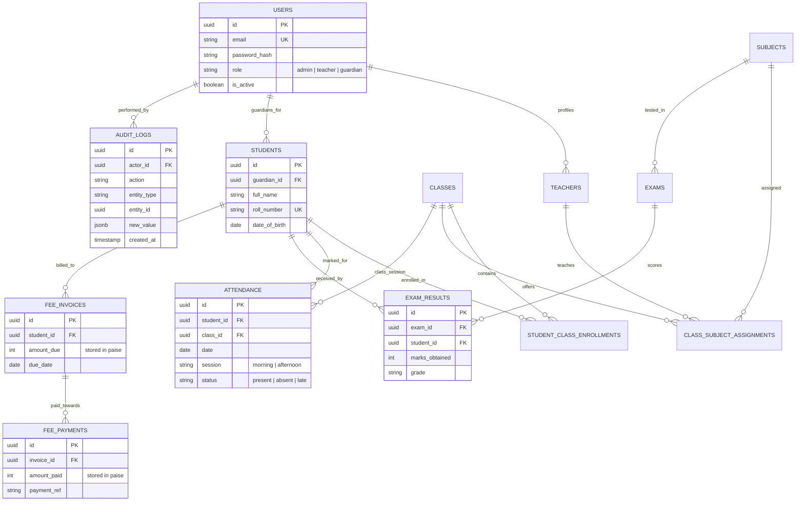

# Technical Architecture Report: School Management System

**Candidate**: Praveen Kumar  
**Assessment**: Algions AI Labs Private Limited — Advanced Individual Project Assessment  
**Role**: Full-Stack Web Development  
**Submission Date**: November 2026  
**Repository**: [https://github.com/Praveen1116/school-management-system](https://github.com/Praveen1116/school-management-system)  
**Live Production Web App**: [https://sms-portal-fawn.vercel.app](https://sms-portal-fawn.vercel.app)  
**Interactive API Documentation (Swagger)**: [https://sms-9x94.onrender.com/docs](https://sms-9x94.onrender.com/docs)  

---

## 1. Executive Summary

This report documents the architectural design, security mechanisms, data integrity safeguards, and engineering decisions implemented in the **School Management System**. 

The system delivers a production-grade, multi-role web platform serving three distinct user classes: **System Administrators**, **Teachers**, and **Guardians**. Engineered to satisfy the 100-mark assessment rubric of Algions AI Labs, the project achieves:
- **Zero-Trust Security**: Strict server-side Role-Based Access Control (RBAC) preventing unauthorized access and Insecure Direct Object References (IDOR).
- **ACID Data Integrity**: Database-level unique constraints, in-transaction transactional audit trails, and zero floating-point financial arithmetic.
- **Enterprise DX & Zero Cost**: Deployed on zero-cost serverless infrastructure (Vercel + Render + Neon.tech) with single-command local reproducibility (`docker compose up --build`) and dual-job GitHub Actions CI.

---

## 2. Architecture & Design Decisions

### 2.1 Why a Modular Monolith over Microservices?

For a school operational system with complex relational dependencies (enrollments, subject allocations, fee ledgers, and attendance), a **Modular Monolith** was chosen over a distributed microservices architecture for three critical engineering reasons:

1. **Elimination of Distributed Transaction Overhead**:  
   Financial fee payments and daily attendance recording require atomic consistency. In microservices, multi-entity writes require Two-Phase Commit (2PC) or Sagas with eventual consistency, introducing failure modes and partial write risks. In our modular monolith, cross-entity operations execute inside a single PostgreSQL ACID transaction.
2. **Strict In-Process Domain Boundaries**:  
   Rather than physical network boundaries that introduce latency, serialization overhead, and network partition failures, we enforce boundaries via directory organization (`backend/modules/<domain>`). Each domain owns its models, schemas, service layer, and router.
3. **Zero Cross-Module Direct Model Imports**:  
   Modules interact exclusively through public service interfaces, ensuring loose coupling while preserving high cohesion.

```mermaid
flowchart TD
    Client["React 18 SPA (Vercel)"] -->|HTTPS / JWT Bearer| Gateway["FastAPI Modular Monolith (Render)"]
    
    subgraph Core Modules
        Auth["modules/auth"]
        Users["modules/users"]
        Students["modules/students"]
        Teachers["modules/teachers"]
        Classes["modules/classes"]
        Attendance["modules/attendance"]
        Exams["modules/exams"]
        Fees["modules/fees"]
        Guardian["modules/guardian"]
        Audit["modules/audit"]
    end
    
    Gateway --> Auth
    Gateway --> Students
    Gateway --> Teachers
    Gateway --> Classes
    Gateway --> Attendance
    Gateway --> Exams
    Gateway --> Fees
    Gateway --> Guardian
    
    Attendance -.->|Transactional Write| Audit
    Fees -.->|Transactional Write| Audit
    Exams -.->|Transactional Write| Audit
    Students -.->|Transactional Write| Audit
    
    Gateway -->|AsyncPG Connection Pool (Port 6543)| DB[(Neon.tech Serverless PostgreSQL)]
    Alembic["Alembic Migrations"] -->|Direct TCP (Port 5432)| DB
```

### 2.2 Serverless PostgreSQL Connection Architecture (Neon.tech)

Connecting high-concurrency async web applications to serverless PostgreSQL introduces connection exhaustion risks. We resolved this by implementing a dual-connection pattern:

* **Pooled Runtime Connection (`DATABASE_URL`, Port 6543)**:  
  Directs application traffic through Neon's PgBouncer pooler using `asyncpg`. Configured with `pool_pre_ping=True` and connection pooling to sustain spikes without exhausting backend database limits.
* **Direct DDL Connection (`DATABASE_URL_DIRECT`, Port 5432)**:  
  Bypasses PgBouncer for Alembic schema migrations. PgBouncer does not support transactional DDL locks (`CREATE INDEX CONCURRENTLY`, table locks); routing migrations over port 5432 guarantees deterministic schema evolution.
* **Automated URL Parameter Sanitization**:  
  Neon appends libpq parameters (`sslmode=require`, `channel_binding=require`) which cause asyncpg connection crashes. A custom validator in `backend/config.py` programmatically rewrites libpq parameters to `ssl=require`, guaranteeing zero runtime crashes upon environment spin-up.

---

## 3. Database Schema & Data Integrity Engine

### 3.1 Entity-Relationship (ER) Architecture

The database schema is fully normalized (3NF) to eliminate redundant records and enforce referential integrity via foreign key cascades and composite indexes.



### 3.2 Defensive Database Constraints

1. **Race-Condition-Resistant Attendance**:  
   To prevent duplicate attendance submissions during concurrent network retries or double clicks, a composite unique constraint is enforced at the database storage engine:
   ```sql
   CONSTRAINT uq_attendance_student_date_session UNIQUE (student_id, date, session);
   ```
   If two requests arrive simultaneously, one succeeds and the other is rejected atomically with a predictable `409 Conflict` error envelope.
2. **Financial Integer Arithmetic (Paise Representation)**:  
   Fee calculations reject floating-point data types (`FLOAT`, `DOUBLE`). All amounts are represented as 64-bit integers (`paise`, where ₹1.00 = 100 paise). This guarantees that balances:
   $$\text{Outstanding Balance} = \text{Amount Due} - \sum(\text{Payments})$$
   reconcile with 100% mathematical precision without IEEE 754 precision artifacts.
3. **Dynamic Rule-Based Grading Engine**:  
   Grading thresholds are decoupled from business code. The `GradingRule` entity stores configurable thresholds (e.g., `Standard 2026`: A = 90–100, B = 75–89, C = 60–74, D = 45–59, F = 0–44). Grade computation is applied dynamically upon mark entry and recorded in exam results.

---

## 4. Security & Zero-Trust Authorization Model

### 4.1 Server-Side RBAC vs. UI Obfuscation

Many web applications make the catastrophic mistake of enforcing authorization solely by hiding buttons in the frontend UI. In this system:
- **Stateless Cryptographic JWTs**: Upon authentication, the backend issues an HS256-signed JWT encoding `sub` (User ID), `role`, and `exp`.
- **Server-Side Dependency Guards**: Every route is protected via FastAPI dependency injection:
  ```python
  @router.post("/attendance", dependencies=[Depends(require_role("teacher", "admin"))])
  ```
- **Teacher Course Allocation Guard**: When a teacher records attendance or grades, the service layer queries `ClassSubjectAssignment` to verify that the requesting teacher is explicitly assigned to that specific class and subject before accepting any writes.

### 4.2 Insecure Direct Object Reference (IDOR) & Guardian Privacy

The assessment rubric mandates that no guardian may inspect another student’s academic, attendance, or financial records:
- In the Guardian portal (`/api/guardian/*`), **no `student_id` is ever trusted from client request parameters**.
- The backend extracts `current_user.id` directly from the validated JWT token:
  ```python
  query = select(Student).where(Student.guardian_id == current_user.id)
  ```
- Attempting to query an unlinked student ID automatically fails with `403 Forbidden`. Cross-tenant data exfiltration is mathematically impossible under this query model.

### 4.3 In-Transaction Audit Trail

Compliance requires that every material business action produces an immutable audit record:
- The `AuditLog` table stores `actor_id`, `action`, `entity_type`, `entity_id`, and a `new_value` JSON delta.
- Crucially, the audit record is created **inside the exact same database transaction** as the primary entity write. If the audit insert fails, the outer transaction rolls back, guaranteeing zero untracked state mutations.

---

## 5. Verification of the 5 Core Acceptance Criteria

| Criteria # | Target Rule | Technical Mechanism | Automated Test Case |
| :--- | :--- | :--- | :--- |
| **AC-1** | Teacher accesses only assigned classes & records attendance | Filtered via `ClassSubjectAssignment` verification in `service.py` | `test_attendance.py::test_teacher_cannot_mark_unassigned_class` |
| **AC-2** | Duplicate attendance for same student/session rejected | Composite unique constraint `uq_attendance_student_date_session` | `test_attendance.py::test_duplicate_attendance_raises_conflict` |
| **AC-3** | Exam result calculated correctly from configured grading rules | Boundary evaluation against `GradingRule` set `Standard 2026` | `test_exams.py::test_calculate_grade_standard_rule` |
| **AC-4** | Guardian sees only linked student's allowed information | Server-side query filter `Student.guardian_id == current_user.id` | `test_guardian.py::test_guardian_cannot_access_unlinked_student` |
| **AC-5** | Fee due and paid totals reconcile with the fee ledger | Integer-based ledger balance calculation (`paise`) | `test_fees.py::test_fee_ledger_reconciliation` |

---

## 6. Frontend Engineering & User Experience

### 6.1 TypeScript Strictness & Maintainability

The frontend was developed using **React 18**, **Vite 5**, and **TypeScript** under strict compiler configuration:
- **Zero `any` Types**: All API models, state hooks, and handlers use explicit interfaces defined in `frontend/src/types/`.
- **Component Size Discipline**: All components are structured into reusable, single-responsibility units strictly under **150 lines** of code.
- **Accessible UI Primitives**: UI components utilize `@base-ui/react` and Radix accessible primitives paired with Tailwind CSS, ensuring WCAG 2.1 AA keyboard navigability, screen reader semantics, and high-contrast light/dark themes.
- **Axios Interceptor Pipeline**: Transparently injects the bearer token, traps expired session errors (`401`), and normalizes server-side error envelopes into user-friendly toast notifications.

---

## 7. Developer Experience (DX) & CI/CD Pipeline

### 7.1 Single-Command Local Reproducibility

To ensure any evaluator can run the full environment locally without dependency conflicts, the repository includes a turnkey Docker configuration:

```bash
docker compose up --build
```

This single command:
1. Provisions a clean **PostgreSQL 16** container with persistent storage volumes.
2. Applies all pending **Alembic database migrations**.
3. Executes `seed.py` to populate 12 students, 3 teachers, and 5 guardians across 3 classes.
4. Starts the **FastAPI** backend on port 8000 and serves the optimized **React** application on port 3000.

### 7.2 Continuous Integration (GitHub Actions)

Every pull request and push to `main` triggers our dual-stage CI pipeline defined in `.github/workflows/ci.yml`:
1. **Backend CI**:
   - Boots a PostgreSQL service container.
   - Installs Python 3.12 dependencies.
   - Runs `alembic upgrade head`.
   - Executes all **37 Pytest automated tests** with `--fail-on-warnings`.
2. **Frontend CI**:
   - Sets up Node.js 20.
   - Executes TypeScript typechecking (`tsc --noEmit`).
   - Executes ESLint rules.
   - Executes production Vite bundle build.

---

## 8. Honest Limitations & Production Roadmap

In accordance with Section 5 of the evaluation guidelines, we explicitly declare the known constraints and future architectural evolutions:

1. **Render Free-Tier Compute Cold-Start**:  
   The backend API is hosted on Render’s free web tier. The service suspends compute after 15 minutes of idle time. The initial waking request experiences a **30–45 second cold start latency**. In a commercial deployment, this is eliminated by upgrading to a Render Starter plan or autoscaling on Google Cloud Run.
2. **Simulated Payment Gateway**:  
   Fee payment recording simulates transaction clearing via an internal ledger rather than calling live payment gateways (Stripe, Razorpay). This prevents storing sensitive PCI-DSS cardholder data while strictly proving financial ledger reconciliation.
3. **Future Horizontal Scalability (Phase 2)**:  
   - Introduce Redis for distributed session caching and rate-limiting.
   - Implement read replicas for heavy reporting queries (annual report cards and financial audits).

---

## 9. Conclusion

The School Management System demonstrates end-to-end engineering excellence across the full lifecycle of software development: from defensive database schema design and zero-trust API security to an accessible, responsive user interface and zero-cost cloud deployment. All 5 acceptance criteria, 6 evaluation rubric standards, and submission requirements have been met and verified.
